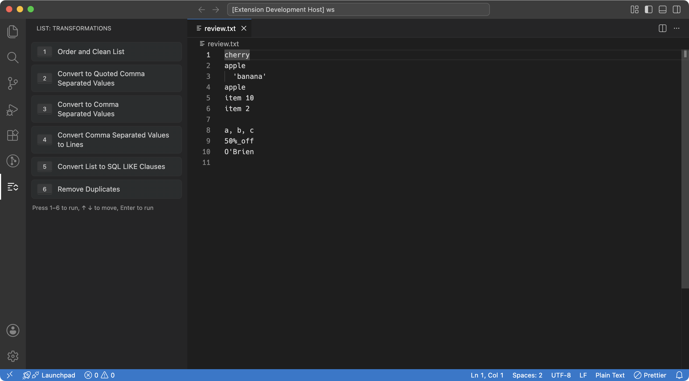
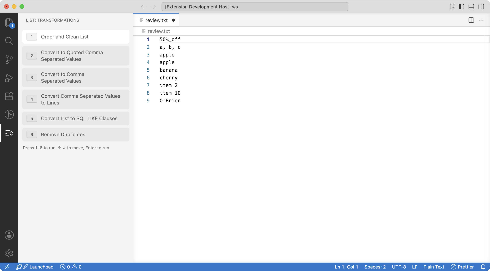

# List Transformation Extension for VSCode

This Visual Studio Code extension offers a suite of list transformation commands, ideal for developers who frequently work with lists of strings. It is particularly useful in preparing data for database operations or scripting data processing tasks.
This project is the basis and we can add in the future more commands or other utils 



## Features

- **Order and Clean List**: Clean each line (trim it, drop one trailing comma, strip the surrounding quotes), drop the lines that clean to empty, and sort in natural order: numbers by value, so `item9` comes before `item10`, and an accented letter next to its base letter. Duplicates are kept; use **Remove Duplicates** for that.
- **Remove Duplicates**: Remove duplicate entries from a list, keeping the first occurrence of each in its original order. Each line is cleaned the same way as in **Order and Clean List**, so `'a'`, ` a ` and `a,` count as `a`, and the lines that clean to empty are dropped. Matching is case-sensitive.
- **Convert to Comma-Separated Values**: Transform a list into a single line of comma-separated values.
- **Convert to Quoted Comma-Separated Values**: Convert a list into a single line of comma-separated values, with each item enclosed in quotes.
- **Convert Comma-Separated Values to Lines**: Turn a string of comma-separated values into individual lines.
- **Convert List to SQL LIKE Clauses**: Create SQL `LIKE` clauses from a list, facilitating database searches.

## Installation

1. Launch Visual Studio Code.
2. Open the Extensions sidebar by clicking the square icon on the Activity Bar or by using the shortcut `Ctrl+Shift+X`.
3. Search for `List Transformation`.
4. Click on the `Install` button to install the extension.

## Usage

Use the Command Palette `Ctrl+Shift+P` (or `Cmd+Shift+P` on Mac) to access the following commands:

- **LIST: Order and Clean List**: Clean lines (trim, drop a trailing comma, strip surrounding quotes), drop empty lines, and sort in natural order (numbers by value). Duplicates stay.
- **LIST: Remove Duplicates**: Remove duplicate lines, keeping first-occurrence order; lines are cleaned the same way first, and empty lines are dropped.
- **LIST: Convert to Comma Separated Values**: Take multiple lines and join them into one line separated by commas.
- **LIST: Convert to Quoted Comma Separated Values**: Convert lines into a comma-separated list, with each item quoted.
- **LIST: Convert Comma Separated Values to Lines**: Split a comma-separated string back into individual lines.
- **LIST: Convert List to SQL LIKE Clauses**: Generate a sequence of SQL LIKE statements from a list of values.

### Pane

The extension also adds a **List** pane, with one button per command. A button runs the same command as the Command Palette, on the selection, or on the whole document when nothing is selected.



The pane opens from the **List** icon in the activity bar, on the left. You can drag the icon to the secondary side bar to keep the pane on the right.

While the pane has focus, press `1` to `6` to run a transformation, `↑` `↓` to move between buttons, and `Enter` to run the focused one.

**Convert List to SQL LIKE Clauses** opens a form under its button instead of three prompts: type the **Column**, pick the **Database** (`mysql` by default, `sqlserver`, `pgsql` or `other`) and the **Join** (`AND`, or `OR` by default), then press `Enter` or **Run**. `Esc` closes the form. The pane remembers the last column, database and join. The number and arrow keys do not run or move buttons while you type in the form. The form trims the column and refuses one that holds a hidden character, such as a tab or a line separator. The Command Palette command keeps its three prompts.


Settings:

- `listTransformation.panel.enabled` (default `true`) controls the pane. Set it to `false` to hide the pane.
- `listTransformation.panel.numberKeys` (default `true`) controls the number keys `1` to `6` in the pane. Set it to `false` to turn them off.


The 6 commands and **Focus on Transformations View** can also be bound to your own shortcuts in **Keyboard Shortcuts** (`Ctrl+K Ctrl+S`, or `Cmd+K Cmd+S` on Mac). The extension adds no default keybinding.

## Examples

Given a list like this:

```
Zebra123
Apple456
Echo789
```

- After using **LIST: Order and Clean List**, you'll get:

```
Apple456
Echo789
Zebra123
```

- After using **LIST: Convert to Comma Separated Values**:

```
Zebra123, Apple456, Echo789
```

- After using **LIST: Convert to Quoted Comma Separated Values**:

```
'Zebra123', 'Apple456', 'Echo789'
```

- Given a comma-separated string, using **LIST: Convert Comma Separated Values to Lines** will result in:

```
Zebra123
Apple456
Echo789
```

- Using **LIST: Convert List to SQL LIKE Clauses** with a column name of `myColumn`, the `mysql` database type and `OR` would produce:

```
`myColumn` LIKE '%Zebra123%' OR
`myColumn` LIKE '%Apple456%' OR
`myColumn` LIKE '%Echo789%'
```

The column is quoted for the database type you pick: `` `myColumn` `` for `mysql`, `[myColumn]` for `sqlserver`, and `"myColumn"` for `pgsql` and `other`.

A value that contains a LIKE wildcard (`%`, `_`, and `[` on SQL Server) or a backslash (MySQL, pgsql and other) gets `ESCAPE '!'`, so it matches only itself: `50%` becomes `LIKE '%50!%%' ESCAPE '!'`. Other values stay as shown above. BigQuery and Azure Synapse do not support `ESCAPE`, so such a clause fails there with a syntax error.


## Contributing

Contributions are always welcome! Please feel free to submit pull requests or create issues for bugs and feature requests.

## License

This extension is released under the MIT License. See the LICENSE file in the repository for more information.
