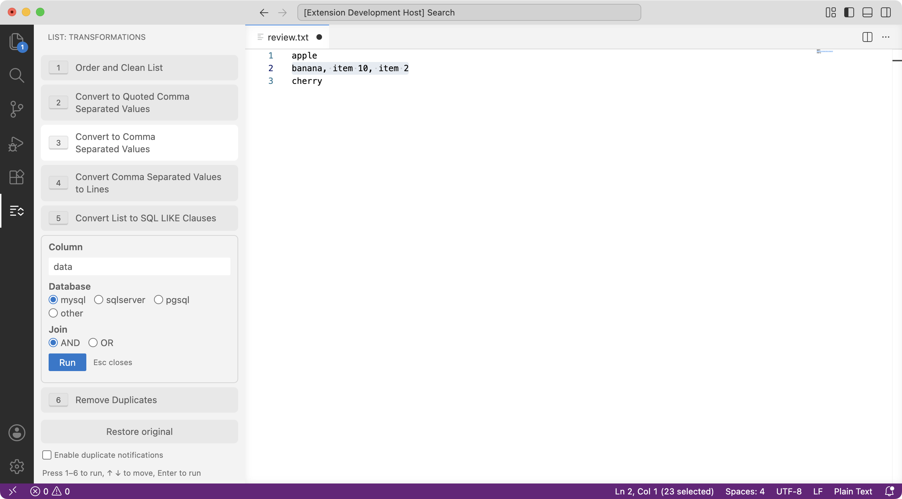
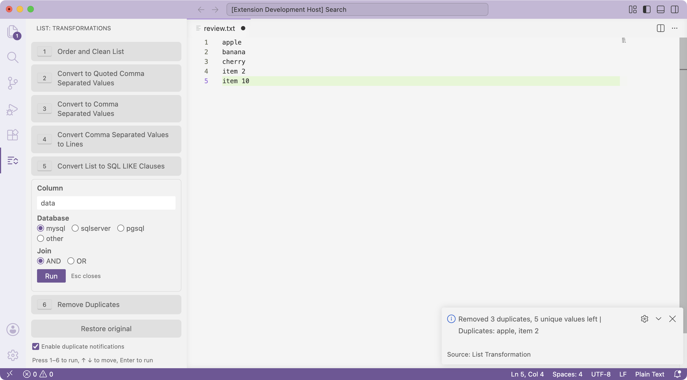
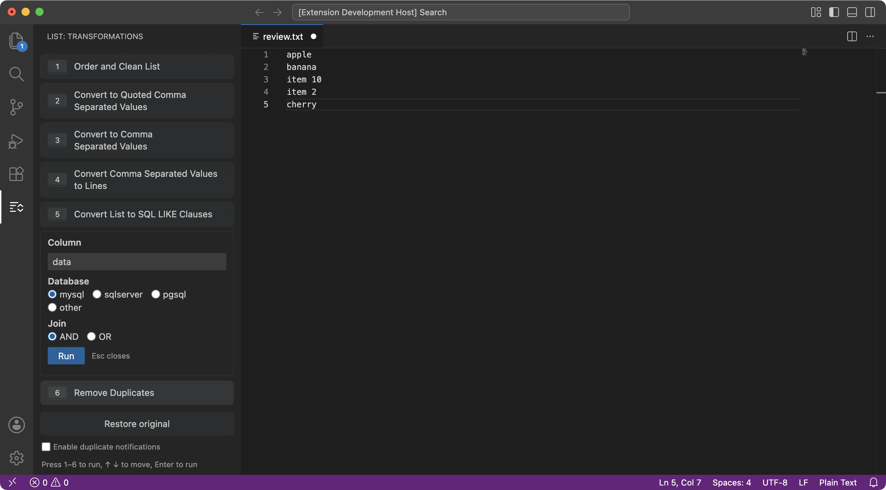
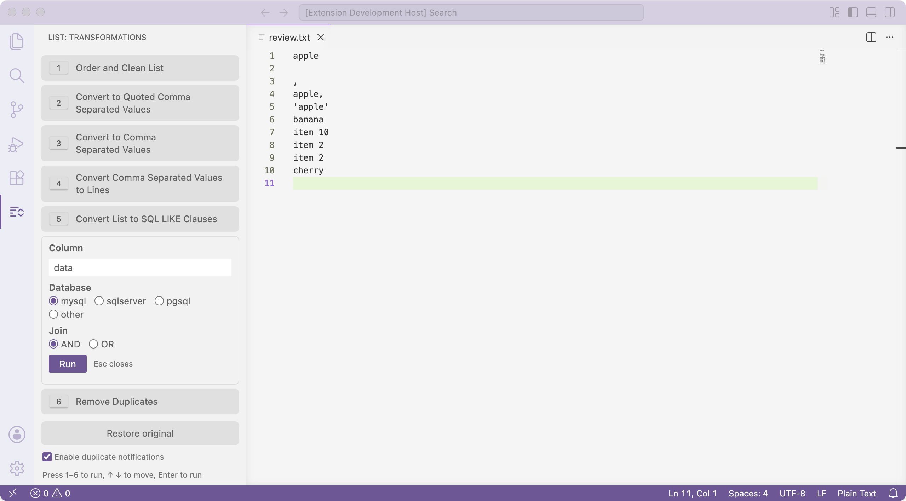
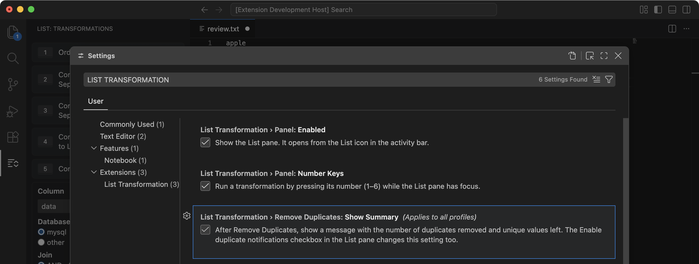
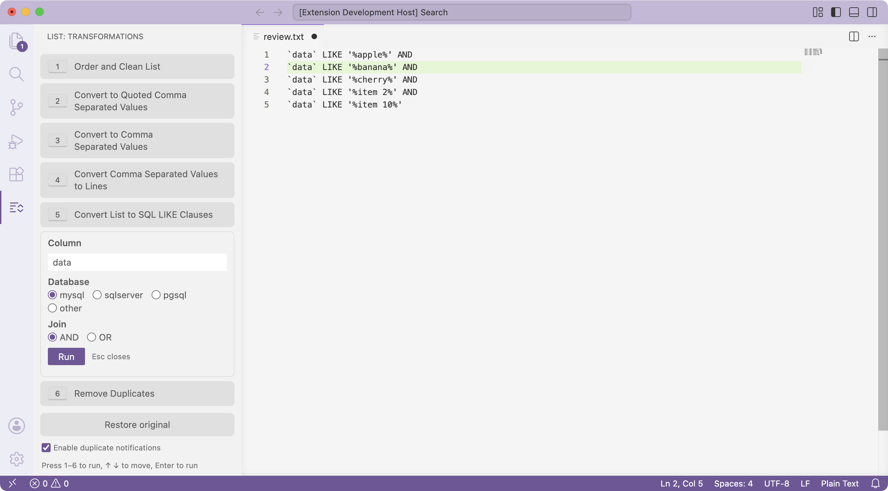

# List Transformation Extension for VSCode

This Visual Studio Code extension offers a suite of list transformation commands, ideal for developers who frequently work with lists of strings. It is particularly useful in preparing data for database operations or scripting data processing tasks.
This project is the basis and we can add in the future more commands or other utils 



## Features

- **Order and Clean List**: Clean each line (trim it, drop one trailing comma, strip the surrounding quotes), drop the lines that clean to empty, and sort in natural order: numbers by value, so `item9` comes before `item10`, and an accented letter next to its base letter. Duplicates are kept; use **Remove Duplicates** for that.
- **Remove Duplicates**: Remove duplicate entries from a list, keeping the first occurrence of each in its original order. Each line is cleaned the same way as in **Order and Clean List**, so `'a'`, ` a ` and `a,` count as `a`, and the lines that clean to empty are dropped. Matching is case-sensitive. When it removes at least one duplicate, an Info message says how many it removed and how many unique values remain, and which values were duplicated, for example `Removed 2 duplicates, 20 unique values left | Duplicates: apple, banana`. The arrow on the message shows the whole list. VS Code cuts a message at 1000 characters, and **Copy Text** copies it. Empty lines are not counted as duplicates; when the run drops any, the message adds `, empty lines dropped` after the counts. A final empty line after the last line break does not count.
- **Convert to Comma-Separated Values**: Transform a list into a single line of comma-separated values.
- **Convert to Quoted Comma-Separated Values**: Convert a list into a single line of comma-separated values, with each item enclosed in quotes.
- **Convert Comma-Separated Values to Lines**: Turn a string of comma-separated values into individual lines.
- **Convert List to SQL LIKE Clauses**: Create SQL `LIKE` clauses from a list, facilitating database searches.

A list on one line of values separated by a comma and a space, such as the output of **Convert to Quoted Comma-Separated Values**, is read as a list of its values by every command except **Convert Comma-Separated Values to Lines**, and **Order and Clean List** and **Remove Duplicates** keep it on one line: `'b', 'a', 'b'` gives `'a', 'b', 'b'` and `'b', 'a'`. A single quoted value such as `'Smith, John'` stays one value, and a comma without a space stays inside a value, so `1,000` is one value.

## Installation

1. Launch Visual Studio Code.
2. Open the Extensions sidebar by clicking the square icon on the Activity Bar or by using the shortcut `Ctrl+Shift+X`.
3. Search for `List Transformation`.
4. Click on the `Install` button to install the extension.

## Usage

Use the Command Palette `Ctrl+Shift+P` (or `Cmd+Shift+P` on Mac) to access the following commands:

- **LIST: Order and Clean List**: Clean lines (trim, drop a trailing comma, strip surrounding quotes), drop empty lines, and sort in natural order (numbers by value). Duplicates stay.
- **LIST: Remove Duplicates**: Remove duplicate lines, keeping first-occurrence order; lines are cleaned the same way first, and empty lines are dropped.
- **LIST: Convert to Comma Separated Values**: Take multiple lines and join them into one line separated by commas.
- **LIST: Convert to Quoted Comma Separated Values**: Convert lines into a comma-separated list, with each item quoted.
- **LIST: Convert Comma Separated Values to Lines**: Split a comma-separated string back into individual lines.
- **LIST: Convert List to SQL LIKE Clauses**: Generate a sequence of SQL LIKE statements from a list of values.
- **LIST: Restore Original List**: Bring back the text from before the transformations, as the **Restore original** button in the pane does.

### Pane

The extension also adds a **List** pane, with one button per command. A button runs the same command as the Command Palette, on the selection, or on the whole document when nothing is selected.



The pane opens from the **List** icon in the activity bar, on the left. You can drag the icon to the secondary side bar to keep the pane on the right.

While the pane has focus, press `1` to `6` to run a transformation, `↑` `↓` to move between buttons, and `Enter` to run the focused one.

The **Enable duplicate notifications** checkbox under the buttons turns the Remove Duplicates message on or off. It changes the `listTransformation.removeDuplicates.showSummary` setting, and a change made in Settings shows in the checkbox.

The **Restore original** button above the checkbox brings back the text from before the first transformation of the current chain. Transformations run one after another form a chain; a hand edit followed by a transformation starts a new one. When the document was edited after the last transformation, it asks first; an Undo counts as an edit too. One Undo brings the transformed text back. The original is kept in memory only, until the document closes or you change its language mode.

**Convert List to SQL LIKE Clauses** opens a form under its button instead of three prompts: type the **Column**, pick the **Database** (`mysql` by default, `sqlserver`, `pgsql` or `other`) and the **Join** (`AND`, or `OR` by default), then press `Enter` or **Run**. `Esc` closes the form. The pane remembers the last column, database and join. The number and arrow keys do not run or move buttons while you type in the form. The form trims the column and refuses one that holds a hidden character, such as a tab or a line separator. The Command Palette command keeps its three prompts.





Settings:

- `listTransformation.panel.enabled` (default `true`) controls the pane. Set it to `false` to hide the pane.
- `listTransformation.panel.numberKeys` (default `true`) controls the number keys `1` to `6` in the pane. Set it to `false` to turn them off.
- `listTransformation.removeDuplicates.showSummary` (default `true`) controls the message after **Remove Duplicates**. Set it to `false`, or uncheck **Enable duplicate notifications** in the pane, to turn it off. It is a user setting: a value in a workspace `settings.json` has no effect. VS Code's own **Turn Off Info and Warning Notifications from 'List Transformation'** (in the gear menu of the message) and Do Not Disturb hide the message even when this setting is `true`.



The 7 commands and **Focus on Transformations View** can also be bound to your own shortcuts in **Keyboard Shortcuts** (`Ctrl+K Ctrl+S`, or `Cmd+K Cmd+S` on Mac). The extension adds no default keybinding.

## Examples

Given a list like this:

```
Zebra123
Apple456
Echo789
```

- After using **LIST: Order and Clean List**, you'll get:

```
Apple456
Echo789
Zebra123
```

- After using **LIST: Convert to Comma Separated Values**:

```
Zebra123, Apple456, Echo789
```

- After using **LIST: Convert to Quoted Comma Separated Values**:

```
'Zebra123', 'Apple456', 'Echo789'
```

- Given a comma-separated string, using **LIST: Convert Comma Separated Values to Lines** will result in:

```
Zebra123
Apple456
Echo789
```

- Using **LIST: Convert List to SQL LIKE Clauses** with a column name of `myColumn`, the `mysql` database type and `OR` would produce:

```
`myColumn` LIKE '%Zebra123%' OR
`myColumn` LIKE '%Apple456%' OR
`myColumn` LIKE '%Echo789%'
```

The column is quoted for the database type you pick: `` `myColumn` `` for `mysql`, `[myColumn]` for `sqlserver`, and `"myColumn"` for `pgsql` and `other`.

A value that contains a LIKE wildcard (`%`, `_`, and `[` on SQL Server) or a backslash (MySQL, pgsql and other) gets `ESCAPE '!'`, so it matches only itself: `50%` becomes `LIKE '%50!%%' ESCAPE '!'`. Other values stay as shown above. BigQuery and Azure Synapse do not support `ESCAPE`, so such a clause fails there with a syntax error.



## Contributing

Contributions are always welcome! Please feel free to submit pull requests or create issues for bugs and feature requests.

## License

This extension is released under the MIT License. See the LICENSE file in the repository for more information.
